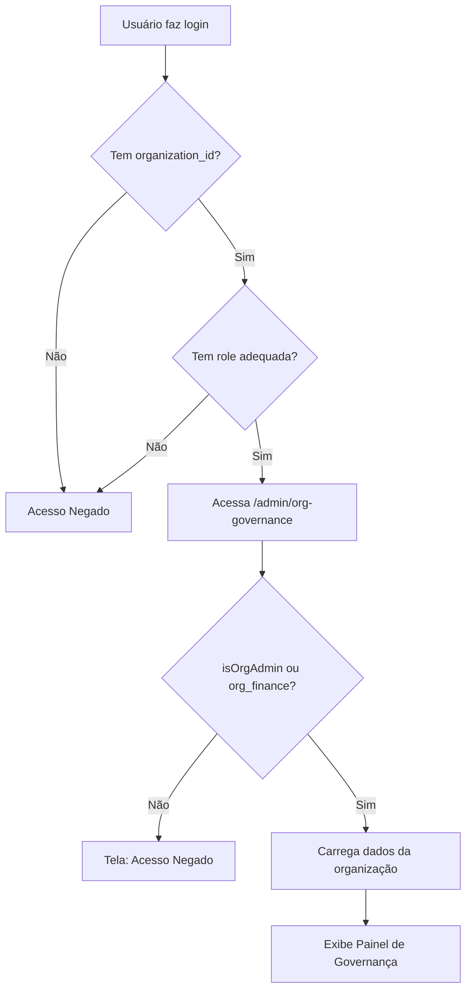

# Guia de Acesso ao Painel de Governança
**CleanFlow/ClinFlow - Governança Organizacional**

---

## 📋 Visão Geral

O **Painel de Governança Organizacional** (`OrgGovernance`) é uma funcionalidade para **organizações multi-unidade** que permite:
- Visualizar métricas consolidadas de todas as unidades
- Gerenciar configurações globais da organização
- Configurar settings específicas por unidade
- Monitorar desempenho (ocupação, no-show, agendamentos)

---

## 🔐 Requisitos de Acesso

### 1. Tipo de Tenant
O usuário deve pertencer a uma **organização** (não apenas um tenant simples):
- ✅ Tenant com `organization_id` preenchido
- ✅ Organização cadastrada na tabela `organizations`
- ❌ Tenants solo (sem organização) NÃO têm acesso

### 2. Roles Permitidas
O painel está protegido por `RoleGuards.financial`, que inclui:

| Role | Descrição | Acesso |
|------|-----------|--------|
| `org_admin` | Administrador da Organização | ✅ Total |
| `org_finance` | Financeiro da Organização | ✅ Total |
| `admin_tenant` | Admin do Tenant | ✅ Se tenant pertence a org |
| `financeiro_tenant` | Financeiro do Tenant | ✅ Se tenant pertence a org |

**Verificação adicional no componente:**
```tsx
const canAccess = isOrgAdmin || hasRole(['org_finance']);
```

---

## 🌐 Como Acessar

### Opção 1: URL Direta
```
https://seudominio.com/admin/org-governance
```

### Opção 2: Navegação pelo Menu
1. Fazer login com usuário que tenha role adequada
2. Acessar área administrativa (`/admin`)
3. Procurar menu/link para "Governança da Organização"

---

## 🛠️ Configuração Necessária

### 1. Criar Organização
```sql
-- Inserir organização
INSERT INTO public.organizations (nome, tipo)
VALUES ('Minha Rede de Clínicas', 'rede');
```

### 2. Associar Tenant à Organização
```sql
-- Atualizar tenant para pertencer à organização
UPDATE public.tenants
SET organization_id = 'uuid-da-organizacao'
WHERE id = 'uuid-do-tenant';
```

### 3. Criar Unidades
```sql
-- Criar unidades da organização
INSERT INTO public.units (organization_id, nome)
VALUES 
  ('uuid-da-organizacao', 'Unidade Centro'),
  ('uuid-da-organizacao', 'Unidade Zona Sul');
```

### 4. Atribuir Role ao Usuário
```sql
-- Dar role de org_admin ao usuário
INSERT INTO public.profile_users (user_id, tenant_id, role, organization_id)
VALUES (
  'uuid-do-usuario',
  'uuid-do-tenant',
  'org_admin',
  'uuid-da-organizacao'
);
```

---

## 📊 Funcionalidades do Painel

### Aba "Unidades"
Exibe tabela com métricas por unidade:
- **Ocupação:** Taxa de ocupação mensal estimada
- **No-Show:** Percentual de faltas
- **Agendamentos:** Total de agendamentos do mês
- **Ações:** Botão "Configurar" para settings específicas

### Aba "Configurações Globais"
Permite definir configurações padrão para toda a organização:
- **Horários Padrão:** Horários de funcionamento
- **Política de Cancelamento:** Regras de cancelamento
- **Templates Padrão:** Templates de mensagens

**Herança de Configurações:**
- Configurações globais são herdadas por todas as unidades
- Unidades podem fazer override de configurações específicas

---

## 🔍 Fluxo de Acesso Completo



---

## 🚨 Troubleshooting

### Problema: "Acesso Negado"
**Causas possíveis:**
1. ❌ Usuário não tem role adequada
2. ❌ Tenant não pertence a uma organização
3. ❌ `organization_id` não está preenchido no profile

**Solução:**
```sql
-- Verificar role do usuário
SELECT * FROM profile_users WHERE user_id = 'uuid-do-usuario';

-- Verificar organização do tenant
SELECT t.*, p.organization_id 
FROM tenants t
JOIN profiles p ON p.tenant_id = t.id
WHERE p.user_id = 'uuid-do-usuario';
```

### Problema: Painel vazio (sem unidades)
**Causas possíveis:**
1. ❌ Organização não tem unidades cadastradas
2. ❌ View `view_org_analytics` não retorna dados

**Solução:**
```sql
-- Verificar unidades da organização
SELECT * FROM units WHERE organization_id = 'uuid-da-organizacao';

-- Verificar analytics
SELECT * FROM view_org_analytics WHERE organization_id = 'uuid-da-organizacao';
```

---

## 🎯 Exemplo Prático

### Cenário: Rede de Clínicas "Saúde Total"

**1. Criar Organização:**
```sql
INSERT INTO organizations (id, nome, tipo)
VALUES (
  'org-saude-total-uuid',
  'Saúde Total',
  'rede'
);
```

**2. Criar Unidades:**
```sql
INSERT INTO units (organization_id, nome) VALUES
  ('org-saude-total-uuid', 'Saúde Total - Centro'),
  ('org-saude-total-uuid', 'Saúde Total - Bairro Alto'),
  ('org-saude-total-uuid', 'Saúde Total - Shopping');
```

**3. Configurar Usuário Admin:**
```sql
-- Atualizar tenant
UPDATE tenants 
SET organization_id = 'org-saude-total-uuid'
WHERE id = 'tenant-saude-total-uuid';

-- Dar role de org_admin
INSERT INTO profile_users (user_id, tenant_id, role, organization_id)
VALUES (
  'user-admin-uuid',
  'tenant-saude-total-uuid',
  'org_admin',
  'org-saude-total-uuid'
);
```

**4. Acessar:**
- Login: `admin@saudetotal.com`
- URL: `https://app.cleanflow.com/admin/org-governance`
- ✅ Verá dashboard com 3 unidades e métricas consolidadas

---

## 📝 Checklist de Acesso

Use este checklist para garantir que tudo está configurado:

- [ ] Organização criada na tabela `organizations`
- [ ] Tenant associado à organização (`organization_id` preenchido)
- [ ] Unidades criadas e vinculadas à organização
- [ ] Usuário tem role `org_admin` ou `org_finance`
- [ ] `profile_users` tem `organization_id` preenchido
- [ ] Profissionais vinculados às unidades (`unidade_id` em `profiles`)
- [ ] Agendamentos existem para gerar analytics

---

## 🔗 Rotas Relacionadas

| Rota | Descrição | Roles |
|------|-----------|-------|
| `/admin/org-governance` | Painel de Governança | org_admin, org_finance |
| `/organization-manager` | Gestão de Organização | org_admin, org_finance |
| `/unidades` | Gestão de Unidades | admin_tenant, org_admin |
| `/governanca` | Governança do Tenant | admin_tenant |

---

## 💡 Dicas

1. **Primeiro Acesso:** Configure as "Configurações Globais" antes de configurar unidades individuais
2. **Herança:** Use override apenas quando necessário - configurações globais facilitam a gestão
3. **Analytics:** Dados são agregados mensalmente - aguarde alguns dias após criar unidades
4. **Permissões:** `org_admin` tem acesso total, `org_finance` tem acesso apenas a métricas financeiras

---

## 📞 Suporte

Se após seguir este guia você ainda não conseguir acessar:
1. Verifique os logs do navegador (F12 → Console)
2. Confirme que o RLS está permitindo acesso às tabelas
3. Verifique se `useOrganizationContext` está retornando dados corretos

**Logs úteis:**
```tsx
console.log('Profile:', profile);
console.log('Organization ID:', profile?.organization_id);
console.log('Is Org Admin:', isOrgAdmin);
console.log('Has org_finance role:', hasRole(['org_finance']));
```

---

**Última atualização:** 07/12/2024
**Versão:** 1.0
